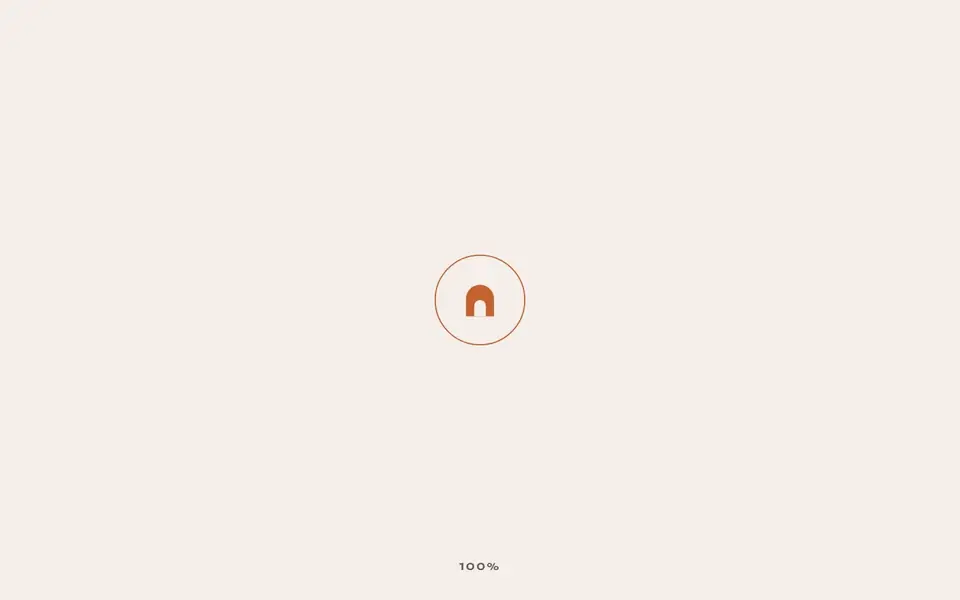
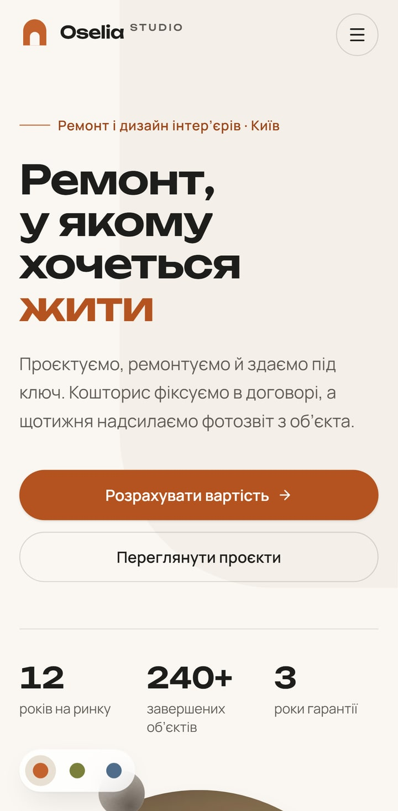
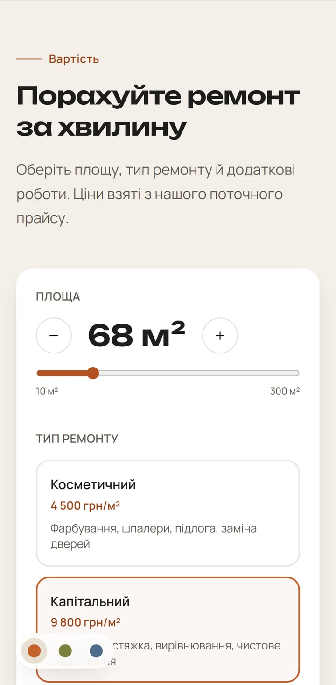
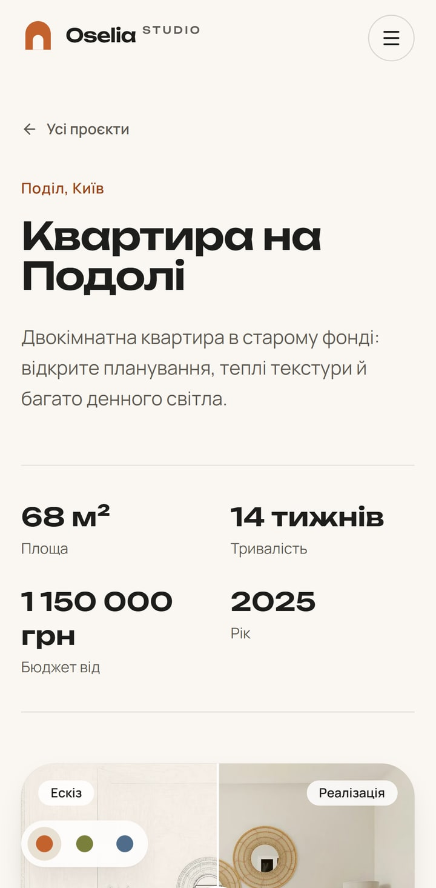

# Oselia Studio

[](https://github.com/IjdmLoverI/oselia-studio/actions/workflows/ci.yml)

A concept website for a renovation studio in Kyiv. It is an animated bilingual landing page
with project pages, a price calculator and a lead form that arrives in Telegram. All content
is edited in a Payload CMS admin.

**Live site:** [oselia-studio.vercel.app](https://oselia-studio.vercel.app). PageSpeed
Insights on 15 October 2026 scored it 99 for performance on mobile and 98 on desktop, with
accessibility at 100.

> **The studio is fictional.** Its contacts and reviews are made up as well. The site is a
> portfolio piece, so it asks search engines not to index it.

> 🇺🇦 **Коротко українською.** Концепт-сайт студії ремонту: анімований лендинг українською
> та англійською, сторінки проєктів, калькулятор вартості, заявки в Telegram. Весь вміст
> редагується в адмінці Payload CMS.

<p align="center">
  
</p>

<p align="center">
  
  
  
</p>

## Features

- **Content from the CMS.** The Payload admin at `/admin` holds everything, in both languages:
  services, projects, reviews, FAQ, prices and contacts.
  - Projects have drafts.
  - Publishing a change refreshes the site without a rebuild.
- **Two languages.**
  - Ukrainian lives at `/uk` and English at `/en`. The root redirects by browser language.
  - Every page has `hreflang` alternates.
- **Motion that stays out of the way:**
  - a one-time intro with word-by-word headings;
  - a pinned sketch-to-photo section;
  - a marquee that speeds up with scroll;
  - material spheres with mouse parallax;
  - a custom cursor, smooth scrolling and a colour mood switcher with view transitions.
  - None of it runs when the system asks for reduced motion, and the pointer effects run on mouse and trackpad only.
- **Price calculator.** It works from rates kept in the CMS. Its estimate carries over into the
  lead form.
- **Lead form.**
  - A server action validates it with zod.
  - Leads are saved in the admin and sent to a Telegram chat.
  - A honeypot, a time trap and a per-IP limit protect it from spam.
- **Project pages.** Each has a sketch-to-result slider that works from the keyboard, a gallery,
  facts and figures, and a link to the next project.
- **SEO.**
  - Sitemap, robots and canonical URLs.
  - Open Graph images generated per language.
  - `HomeAndConstructionBusiness` structured data.
- **Accessibility.** Every end-to-end run includes an axe check. The site has semantic
  landmarks, visible focus and AA contrast.
- **Tests and CI.** Vitest covers the pricing, validation and slug logic. Playwright tests both
  languages on a desktop and a phone viewport. GitHub Actions runs everything against a real
  Postgres.

## Stack

| Area      | Choice                                                          |
| --------- | --------------------------------------------------------------- |
| Framework | Next.js 16 (App Router), React 19, TypeScript                   |
| CMS       | Payload 3 with Postgres, Lexical rich text, Vercel Blob uploads |
| i18n      | next-intl for the site, Payload localization for content        |
| Styling   | Tailwind CSS 4                                                  |
| Motion    | Motion for React, Lenis, CSS animations                         |
| Forms     | Server actions, zod                                             |
| Testing   | Vitest, Playwright, axe-core                                    |
| Tooling   | ESLint, Prettier, husky, lint-staged                            |
| Hosting   | Vercel, Neon Postgres, Vercel Blob                              |

## Quick start

You need Node.js 22 or newer and Docker.

```bash
npm install
cp .env.example .env
```

Set `PAYLOAD_SECRET` in `.env` to a random string of at least 32 characters. Then start the
database, apply the schema and load the demo content:

```bash
npm run db:up
npm run migrate
npm run seed
npm run dev
```

The site opens at <http://localhost:3000> and the admin at <http://localhost:3000/admin>. The
seed creates an admin when `SEED_ADMIN_EMAIL` and `SEED_ADMIN_PASSWORD` are set. Without them,
Payload asks you to create the first user when you open the admin.

## Scripts

| Script                   | What it does                                             |
| ------------------------ | -------------------------------------------------------- |
| `npm run dev`            | Development server                                       |
| `npm run build`          | Production build (needs the database)                    |
| `npm run start`          | Serves the production build                              |
| `npm run lint`           | ESLint                                                   |
| `npm run typecheck`      | Generates route types, then runs `tsc`                   |
| `npm run format`         | Prettier, writing changes                                |
| `npm test`               | Unit tests                                               |
| `npm run e2e`            | End-to-end tests against a production build on port 3100 |
| `npm run db:up`          | Starts Postgres in Docker on `127.0.0.1:5434`            |
| `npm run migrate`        | Applies database migrations                              |
| `npm run migrate:create` | Creates a migration after a schema change                |
| `npm run seed`           | Loads or refreshes the demo content                      |
| `npm run generate:types` | Regenerates `src/payload-types.ts`                       |
| `npm run materials`      | Re-renders the material textures used in the hero        |

## Project structure

```
src/
  app/(frontend)/[locale]/   pages: home, projects/[slug], credits, Open Graph image
  app/(payload)/             admin panel and REST/GraphQL API generated by Payload
  collections/, globals/     content model
  components/                layout, sections, motion, ui
  actions/                   lead form server action
  lib/                       content queries, pricing, validation, Telegram, SEO helpers
  i18n/                      routing and message loading
  migrations/                database migrations
messages/                    interface text in uk and en
scripts/                     seed data and texture rendering
tests/                       unit and end-to-end tests
```

## Documentation

- [Architecture](docs/architecture.md): rendering, caching, i18n, the lead flow and motion.
- [Content model](docs/content-model.md): collections, globals and access rules.
- [Development](docs/development.md): local setup, tests and conventions.
- [Deployment](docs/deployment.md): Vercel, Neon, Vercel Blob and Telegram.
- [Decisions](docs/decisions.md): why the main pieces were chosen.
- [Credits](docs/credits.md): photos, fonts and icons.

## License

The code is released under the [MIT License](LICENSE). The photos come from Unsplash under the
Unsplash License. The fonts are under the SIL Open Font License. See
[docs/credits.md](docs/credits.md).
